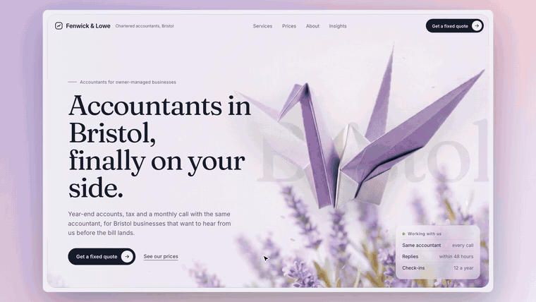

# Accountant Website Builder: a free Claude skill

**Built by [HandL Agency](https://handlagency.com) for UK accountants and bookkeepers.**

Make Claude build a homepage that looks expensive **and** brings in enquiries.



Most accountancy websites open with "Welcome to Smith & Co". Nobody searches for that, and it tells a visitor nothing. This skill builds the page around what actually wins clients:

- **Found on Google and AI search:** the H1 and page title say your service and your town, and the first paragraph answers the question. The build script checks this every time.
- **Turns visitors into enquiries:** one main button everywhere, promises that answer what clients actually worry about, and space for your face and your prices.
- **Stands out:** a cinematic hero with a finance object that moves: coins raining and spinning in 3D, a banknote-paper crane gliding, a gold hummingbird hovering. It flies down the page as you scroll. Six ready-made scenes are included, plus how to make your own.
- **Checks its own work:** Claude screenshots the page, scores it against a rubric and fixes the weakest parts.

## Install

### Claude Code (plugin)
```
/plugin marketplace add handlagency/accountant-website-skill
/plugin install accountant-website-builder@handl
```

### Claude Code (manual)
Copy `plugins/accountant-website-builder/skills/accountant-website-builder` into `~/.claude/skills/`.

### Claude.ai and Claude desktop
Zip the `accountant-website-builder` skill folder, then in Claude open **Customize → Skills → Upload a skill** and switch it on. Code execution needs to be on in Settings.

### Optional: let Claude see its work
```
pip install playwright && python -m playwright install chromium
```

## Try it

Just ask Claude for a website. The skill kicks in automatically:

> Build a homepage for Fenwick & Lowe, chartered accountants in Bristol. We help owner-managed businesses, fixed monthly fees, the same accountant on every call. Mood: calm, expensive, trustworthy. Main button: get a fixed quote.

Six finished briefs, each with its own animated scene, are in `examples/`: accountants, bookkeepers, contractor accountants, e-commerce bookkeeping, tax returns and payroll.

## Before you go live
- Swap in real photos of your team, real prices and your contact or booking link.
- Add your regulatory details to the footer (registered name and number, office, and your supervisory body).
- Never add reviews, client numbers or awards you can't back up.

## Want it done for you?
HandL Agency builds websites, SEO and AI systems for UK accountancy and bookkeeping firms. Not sure where to start? Take the free 3-minute [AI and marketing scorecard](https://handlagency.scoreapp.com).

MIT licence.
